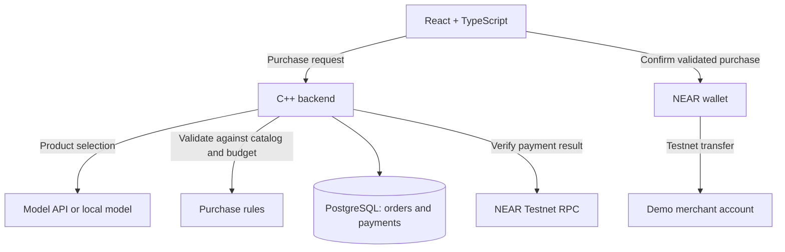

# Community Treasury

A budget-controlled purchasing assistant. An AI model selects a product, the backend validates the purchase, and the user confirms payment through a NEAR wallet.

## Quick start

Install Docker with Compose and enable Linux containers. Then:

```sh
git clone https://github.com/sashcheka/near-hackathon-mogger.git
cd near-hackathon-mogger
docker compose up -d --wait postgres
docker compose run --rm migrate
docker compose exec -T postgres psql -v ON_ERROR_STOP=1 -U treasury -d treasury < backend/db/seed.sql
docker compose up --build -d --wait backend
```

Check `http://localhost:8080/health` for `{"status":"ok"}`. Build/test details and current validation status: [backend setup](backend/README.md).

## Stage 1

One user, a demo store, a real model call, and a user-confirmed NEAR Testnet transfer.



| Component | Location | Responsibility |
| --- | --- | --- |
| C++20 backend | [backend/](backend/) | Catalog, model integration, purchase validation, order history, and payment verification |
| PostgreSQL | Schema managed by backend | Orders and verified payment records |
| React + TypeScript | [frontend/](frontend/) | Request input, purchase review, wallet confirmation, and result display |
| Stage specification | [docs/STAGE_1.md](docs/STAGE_1.md) | Scope, acceptance criteria, and implementation sequence |

The backend derives prices from its catalog and the merchant recipient from server configuration, validates spending limits independently of the model, and holds no wallet keys. Payment success requires verification of the transaction outcome.

Future extensions include scheduled purchases, contract-enforced spending permissions, merchant APIs, NEAR Intents, and collective budgets. Stage 1 uses direct Testnet transfers without a custom Rust contract.

The backend exposes `GET /health`, `GET /products`, `POST /orders`, `POST /purchase-requests`, and `GET /orders/{id}`. Orders save the validated price, configured merchant recipient, and Testnet network. Order retrieval awaits build/test verification; see [backend setup](backend/README.md). The [local Ollama integration](docs/OLLAMA.md) passed 19/20 catalog checks in three reported runs. The [purchase screen](frontend/README.md) runs in the reported browser check. Wallet payments are pending.
