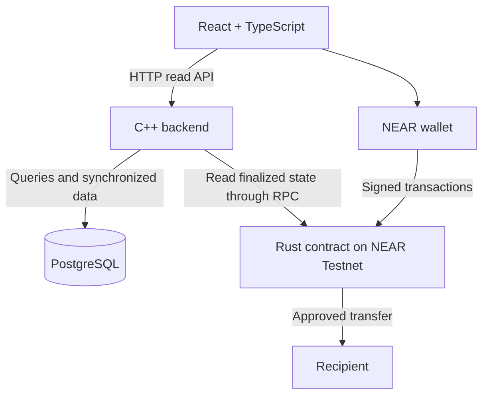

# Community Treasury

A mobile-first application for managing a residential building's shared treasury, improvement proposals, voting, and spending records on NEAR.

## MVP

One building, 5–10 simulated apartments, NEAR Testnet, and test tokens.

- Non-transferable, revocable membership linked to apartment representatives.
- Voluntary contributions to a shared improvement fund.
- Proposals with a fixed amount, recipient, and voting deadline.
- One vote per apartment, with quorum and majority requirements.
- Contract-controlled payments for approved proposals and a public activity history.

## Target architecture

| Component | Location | Technology | Responsibility |
| --- | --- | --- | --- |
| Frontend | `frontend/` | React, TypeScript, Vite | Dashboard, proposals, voting, payment history, and wallet interaction |
| Backend | `backend/` | C++20; userver proposed | Read API, contract synchronization, filtering, and statistics |
| Database | PostgreSQL; migrations in `backend/` | SQL | Queryable projection of contract data for history and reporting |
| Contract | `contracts/treasury/` | Rust, `near-sdk` | Membership, authorization, voting, fund accounting, and payment execution |

Locations describe the planned repository structure.

## Execution and data ownership

The wallet signs state-changing calls directly to the contract. The contract is authoritative for membership, votes, and treasury funds. The manager administers membership; the treasurer initiates approved payments. The backend holds no wallet keys and cannot authorize spending.

The backend reads finalized contract state through NEAR JSON-RPC and updates PostgreSQL by stable record IDs. Repeated synchronization must not duplicate records. PostgreSQL serves the application's history and statistics.

The contract enforces deadlines, quorum, apartment-level vote uniqueness, available funds, and at most one successful payment per proposal. Pending transfers reserve funds; callbacks confirm success or release reservations after a confirmed transfer failure.

Amounts use exact integer yoctoNEAR values with support for the contract's `u128` range and string serialization in JSON. Personal resident information stays off-chain; wallets, votes, and payments are public.
