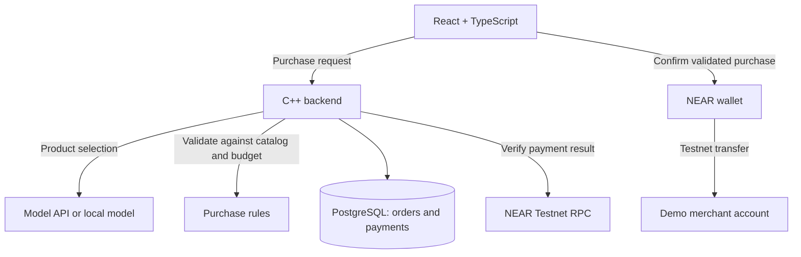

# Community Treasury

A budget-controlled purchasing assistant. An AI model selects a product, the backend validates the purchase, and the user confirms payment through a NEAR wallet.

## Local development

macOS + Colima workflow. Prerequisites: Docker CLI with Compose, Colima, Ollama, and VS Code with Dev Containers. C++, Node.js, and npm run inside the dev container. Install Ollama once with `brew install ollama`. Clone this repository and open its root in VS Code.

**1. Mac terminal, repository root — PostgreSQL.** Start Colima if stopped, then apply migrations and demo data:

```sh
colima start
docker compose up -d --wait postgres &&
docker compose run --rm migrate &&
docker compose exec -T postgres psql -v ON_ERROR_STOP=1 -U treasury -d treasury < backend/db/seed.sql
```

**2. Another Mac terminal — Ollama.** Leave this server running:

```sh
ollama serve
```

Download the model once from another Mac terminal: `ollama pull qwen3:4b`. If Ollama is already serving, reuse that process.

**3. VS Code — Dev Containers: Reopen in Container.** PostgreSQL must be running first to create the Docker network. Existing dev containers can be reopened; rebuild only after environment configuration changes.

**4. Dev container terminal — backend.** The initial build is slow; later builds reuse the persistent build volume. Leave the server running:

```sh
cd /app/backend &&
cmake --preset docker &&
cmake --build --preset docker &&
ctest --preset docker &&
OLLAMA_MODEL=qwen3:4b \
OLLAMA_CHAT_URL=http://host.lima.internal:11434/api/chat \
  ./build/community_treasury_backend --config configs/static_config.yaml
```

For an unchanged, already-built backend, run only the environment assignments and executable from `/app/backend`. `MERCHANT_ACCOUNT_ID` is optional for now: unset means retrieved orders have `payment: null`.

**5. Another dev container terminal — frontend.** Leave Vite running:

```sh
cd /app/frontend &&
npm ci &&
npm test &&
npm run build &&
npm run dev
```

Open `http://localhost:5173` through VS Code's forwarded port. Backend health: `curl --fail http://localhost:8080/health`. Vite forwards `/api` to the backend inside the container. After frontend-only edits, Vite reloads automatically; rerun `npm ci` when dependencies change.

Other host setups and the standalone backend image: [backend setup](backend/README.md); model settings: [Ollama setup](docs/OLLAMA.md).

## Stop all services

1. In the dev container, press `Ctrl+C` in the backend terminal and in the frontend/Vite terminal.
2. On the Mac, press `Ctrl+C` in the terminal running `ollama serve` to stop the model server.
3. Close the VS Code dev container window. Its `shutdownAction: stopContainer` stops the development container.
4. From a Mac terminal in the repository root, stop the Compose services and the Colima VM:

```sh
docker compose stop
colima stop
```

`docker compose stop` stops PostgreSQL and any standalone Compose backend. `colima stop` shuts down the Linux VM. Neither command deletes containers, images, build cache, or volumes. Source files, database data, cached C++ build, VS Code extensions, and Codex sessions are retained. Resume with the startup steps above.

## Wallet connection

Click **Connect wallet**, choose a Testnet-compatible wallet, and approve the connection. The UI shows its account ID, restores the connection after a page reload, and offers **Disconnect**. Use the same browser and `localhost:5173` origin when checking restoration. Integration uses [NEAR Connect](https://docs.near.org/tools/near-connect); the browser needs internet access for the wallet manifest and provider.

If you do not have a Testnet account yet, create one in the selected wallet first. This does not configure the merchant recipient; that separate account will be set up before payments.

Click **Verify ownership** and approve the sign-in message to authenticate the connected account. The backend checks the NEP-413 signature and the account's FullAccess key through Testnet RPC. This does not transfer funds. Authentication requires the latest database migration; see [API and checks](docs/AUTH.md). The tab keeps its token in `sessionStorage`; reload restores verification only after the backend validates the session for the connected account. Reload does not extend the one-hour expiry. Disconnect revokes the session and clears the saved token.

Order creation, retrieval and transfer verification now require a verified session. The backend saves the session account as the buyer and restricts access to its orders; old unowned orders remain stored but cannot be claimed. The frontend sends the token and clears its displayed order when the session changes. Apply migrations before rebuilding the backend. Full build/tests and the updated browser flow still need to be checked. Wallet connection does not mark orders paid.

Click **Orders** to the left of the wallet buttons to load the verified account's
20 latest saved orders with quantity, unit price, total and status. The same button
becomes **← Back to purchase** and returns to the form with its inputs preserved.
The list has a **Refresh** button. Old unowned orders do not appear. The list
requires the updated backend's `GET /orders`; no additional migration is needed.

## Merchant and transfer verification

Create a separate Testnet merchant account in your wallet. Stop the backend and relaunch it from the dev container; replace `your-merchant.testnet` with that account ID:

```sh
cd /app/backend
MERCHANT_ACCOUNT_ID=your-merchant.testnet \
OLLAMA_MODEL=qwen3:4b \
OLLAMA_CHAT_URL=http://host.lima.internal:11434/api/chat \
  ./build/community_treasury_backend --config configs/static_config.yaml
```

Create a new order afterward. `GET /orders/{id}` must show the merchant in `payment.receiver_id`, network `testnet`, and the saved total in `payment.amount_yocto`. Older orders keep their original recipient, including `null`.

`POST /orders/{id}/verify-payment` checks an existing finalized Testnet transfer,
requires it to follow order creation, and atomically records the payment and marks
the owned order `paid`. A transaction cannot pay multiple orders; retrying the same
accepted payment returns its saved result. **Orders** shows `Paid` after refresh.
See [API and errors](docs/PAYMENTS.md). Apply migrations before restarting. Full
build/tests and a real Testnet payment remain pending; the wallet **Pay** button is next.

## Stage 1

One user, a demo store, a real model call, and a user-confirmed NEAR Testnet transfer.



| Component | Location | Responsibility |
| --- | --- | --- |
| C++20 backend | [backend/](backend/) | Catalog, model integration, purchase validation, order history, and payment verification |
| PostgreSQL | Schema managed by backend | Orders and verified payment records |
| React + TypeScript | [frontend/](frontend/) | Request input, purchase review, wallet confirmation, and result display |
| Stage specification | [docs/STAGE_1.md](docs/STAGE_1.md) | Scope, acceptance criteria, and implementation sequence |

The backend derives prices from its catalog and the merchant recipient from server configuration, validates spending limits independently of the model, and holds no wallet keys. Payment success requires verification of the transaction outcome.

Future extensions include scheduled purchases, contract-enforced spending permissions, merchant APIs, NEAR Intents, and collective budgets. Stage 1 uses direct Testnet transfers without a custom Rust contract.

The backend exposes catalog, owned orders, AI selection and durable payment
acceptance. Orders save the validated price, configured merchant and Testnet network.
The [local Ollama integration](docs/OLLAMA.md) passed 19/20 catalog checks in three
reported runs. The [purchase screen](frontend/README.md) and wallet connection passed
earlier browser checks. Updated payment tests and real-transfer validation are pending.
