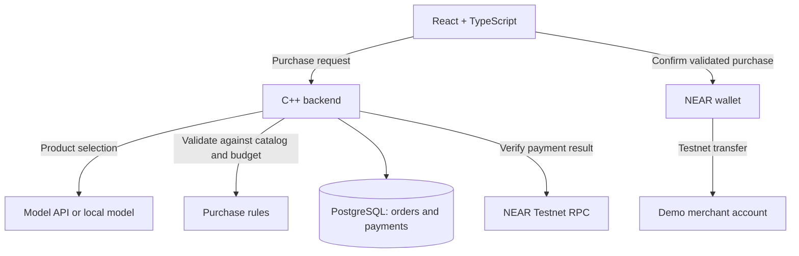

# Community Treasury

A budget-controlled purchasing assistant. An AI model selects a product, the backend validates the purchase, and the user confirms payment through a NEAR wallet.

## Stage 1

One user, a demo store, a real model call, and a user-confirmed NEAR Testnet transfer.

| Component | Location | Responsibility |
| --- | --- | --- |
| C++20 backend | [backend/](backend/) | Catalog, model integration, purchase validation, order history, and payment verification |
| PostgreSQL | Schema managed by backend | Orders and verified payment records |
| React + TypeScript | [frontend/](frontend/) | Request input, purchase review, wallet confirmation, and result display |
| Stage specification | [docs/STAGE_1.md](docs/STAGE_1.md) | Scope, acceptance criteria, and implementation sequence |

The backend derives prices and recipients from its catalog, validates spending limits independently of the model, and holds no wallet keys. Payment success requires verification of the transaction outcome.

Future extensions include scheduled purchases, contract-enforced spending permissions, merchant APIs, NEAR Intents, and collective budgets. Stage 1 uses direct Testnet transfers without a custom Rust contract.

The initial backend exposes `GET /health`. See [backend setup](backend/README.md) for build, test, and run commands. Purchase handling, PostgreSQL, and frontend implementation are pending.
