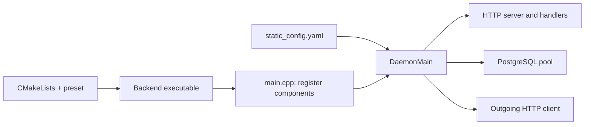
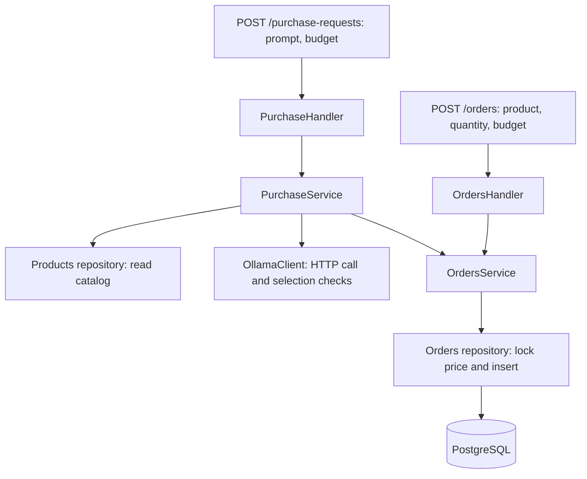

# Backend code walkthrough

## Recent commits

| Commit | Change | Purpose |
| --- | --- | --- |
| `7f89b83` | PostgreSQL component, configuration, and demo catalog | Connect the service to persistent storage |
| `4229400` | Explicit source directory for testsuite | Find database files from the build directory |
| `a1cf5ea` | `GET /products` | Read the actual catalog through HTTP |
| `04eaf1a` | dbmate and separate seeds | Track schema changes independently of demo data |
| `ccd8095` | `POST /orders` | Validate a purchase and store an unpaid price snapshot |
| `4809978` | Ollama client and shared catalog repository | Select a catalog product through a local model |
| `3f55dd3` | `POST /purchase-requests` | Pass model selections through the same order rules |

## Startup

CMake controls compilation and linking. YAML controls the running process: routes, threads, database connection, and model settings. Registering a component in C++ makes its type available; YAML configures its named instance. The names must match.

## Request flow

The purchase service validates the request before inference. After inference, the order service opens a transaction, rereads and locks the selected product, calculates the exact total, checks the budget, inserts the order, and commits. A rejected order or exception leaves no partial order. The stored price remains unchanged when the catalog price changes later.

The application calls C++ services directly; it does not send an internal HTTP request to `/orders`. The model suggests a product and quantity. It cannot set prices, change the budget, or pay.

## userver vocabulary

| Code | Meaning |
| --- | --- |
| `MinimalServerComponentList()` | Framework components needed for the HTTP server |
| `.Append<T>()` | Register a component type; userver constructs its instance |
| `kName` | Component name matched to its YAML section |
| `DaemonMain(...)` | Load config, construct components, serve requests, and handle shutdown |
| `HttpHandlerBase` | Framework base class for an HTTP route |
| `ComponentConfig` | This component's YAML settings |
| `ComponentContext::FindComponent<T>()` | Obtain another component and establish its startup dependency |
| `HandleRequestThrow(...) const` | Request callback; one handler instance can serve concurrent requests |
| `ClusterPtr` / `GetCluster()` | Access to a PostgreSQL cluster and its connection pools |
| `Execute(query, values...)` | Run SQL with separately bound parameter values |
| `Begin()` / `Commit()` | Start / commit a database transaction; unfinished transactions roll back |
| `CreateRequest().post(...).perform()` | Outgoing HTTP request; supported I/O suspends the coroutine while waiting |
| `AsContainer<vector<Product>>(kRowTag)` | Convert SQL rows into structs; selected column order must match field order |
| `GetStaticConfigSchema()` | Describe and validate custom YAML settings for a component |

These calls provide transport, lifecycle, and storage mechanics. `OrdersService`, `PurchaseService`, `Product`, `Order`, and the budget rules are application code.

## Reading order

1. [main.cpp](../backend/src/main.cpp) and [static_config.yaml](../backend/configs/static_config.yaml): what starts and which routes exist.
2. [orders_handler.cpp](../backend/src/handlers/orders_handler.cpp): JSON input and HTTP error mapping.
3. [orders_service.cpp](../backend/src/services/orders_service.cpp): purchase rules and transaction boundary.
4. [orders_repository.cpp](../backend/src/repositories/orders_repository.cpp): parameterized SQL and price locking.
5. [purchase_service.cpp](../backend/src/services/purchase_service.cpp) and [ollama_client.cpp](../backend/src/clients/ollama_client.cpp): model orchestration and protocol.
6. [test_orders.py](../backend/tests/test_orders.py) and [test_purchase.py](../backend/tests/test_purchase.py): externally observable behavior. Tests use real temporary PostgreSQL and a mock Ollama HTTP server.

Direct order creation has been verified manually. The new AI integration still needs compilation, test execution, and real model verification. Wallet payments and the frontend remain outside the implemented flow.
